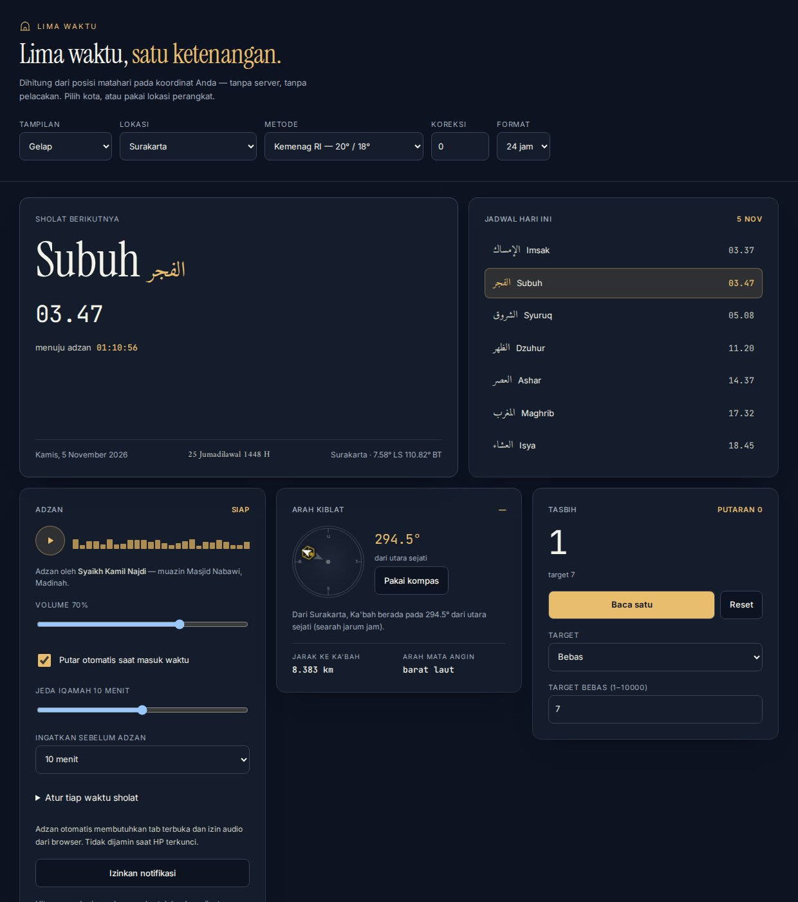

# Lima Waktu

Jadwal sholat, pengingat adzan, arah kiblat, dan pendamping ibadah yang dihitung lokal tanpa akun.

[**Buka aplikasi**](https://atmajadesna.github.io/waktu-sholat/?v=7)



## Fitur

- Jadwal tujuh penanda waktu untuk 18 kota Indonesia, lima metode, koreksi menit, dan format 12/24 jam.
- GPS tersimpan setelah reload. Zona GPS dipilih eksplisit WIB/WITA/WIT; jangan mengasumsikan zona dari pengaturan HP atau garis bujur. Default WIB, sesuaikan bila diperlukan.
- Countdown berdasarkan zona kota, nama sholat mengikuti pergantian waktu, dan jadwal berganti saat tanggal lokasi berubah.
- Audio adzan lokal, volume, pengaktifan per sholat, pengingat 5–20 menit, dan timer iqamah.
- Kiblat: derajat, jarak, arah mata angin dan sensor kompas bila tersedia.
- Checklist pribadi tersimpan lokal, tasbih 33/99/100 atau target bebas.
- Pilih bulan, ekspor CSV (dengan lokasi/metode/koreksi), serta cetak/simpan PDF lewat browser.
- Tema terang/gelap/otomatis menurut jam lokasi (terang pukul 06–18).
- Dzikir ringkas: Arab, transliterasi, arti, dan rujukan Muslim 591–592 serta 597a.
- Mode Ramadan opsional: imsak, Subuh, berbuka dan pengingat sahur 30/60/90 menit.
- PWA: ikon layar utama, app shell offline setelah kunjungan pertama. Audio dicache setelah dimuat daring; file audio belum tentu tersedia pada instalasi pertama.

## Menjalankan

```bash
python3 -m http.server 8000
```

Buka http://localhost:8000. Tidak membutuhkan build. HTTPS atau localhost diperlukan untuk GPS dan service worker.

## Struktur

- `index.html`: struktur dan isi dzikir.
- `app.js`: perhitungan astronomi, penjadwalan, GPS, checklist, audio, kiblat.
- `extras.js`: tema, ekspor, pengaturan tambahan, Ramadan dan instalasi.
- `tokens.css`, `styles.css`, `comfort.css`: token, komponen dasar dan penyempurnaan antarmuka.
- `manifest.webmanifest`, `sw.js`, `icon*`: instalasi dan cache offline.
- `tests/`: pengujian browser dengan Playwright. Jalankan server lokal kemudian `npm install --no-save playwright` dan `npx playwright install chromium`, lalu `node tests/regression.cjs`, `node tests/features.cjs`, dan `node tests/qa.cjs`. Default URL http://127.0.0.1:8000/; override dengan `TEST_URL`.

## Perhitungan & batas

Deklinasi dan persamaan waktu dihitung dari Julian Day, dilanjutkan sudut matahari serta bayangan Ashar. Hasil disesuaikan UTC offset kota dan koreksi pengguna. Ini perhitungan astronomi, **bukan jadwal resmi Kemenag** dan tidak diklaim selalu sama. Cocokkan dengan jadwal resmi setempat, terutama saat berpuasa. Wilayah lintang tinggi yang tidak memiliki peristiwa matahari tertentu belum didukung; GPS ditujukan untuk Indonesia.

- Pengingat hanya berjalan saat halaman terbuka. PWA/offline **tidak menjamin adzan saat aplikasi ditutup, tab ditangguhkan, atau layar terkunci**. Browser bisa memblokir autoplay. Tidak ada push server.
- Imsak ialah pengingat, bukan awal Subuh. Hijriah merupakan estimasi kalender browser, bukan pengumuman resmi awal bulan.
- Kompas bergantung sensor, izin dan kalibrasi; derajat dihitung dari utara sejati, sensor dapat terpengaruh magnet sekitar.
- Checklist bukan penilaian kualitas ibadah. Semua data berada di browser; menghapus data browser menghilangkan catatan.
- Tidak ada server aplikasi atau analytics. Google Fonts dimuat eksternal saat daring; font sistem menjadi fallback offline.
- Tautan sunnah.com dapat dibatasi aksesnya. Isi dzikir diperiksa silang terhadap dataset publik Sahih Muslim di https://github.com/AhmedBaset/hadith-json (riwayat istighfar tiga kali, doa keselamatan dan tasbih 33/33/33). Terjemahan Indonesia adalah terjemahan ringkas.
- URL repo/demo lama dipertahankan agar tautan dan penyimpanan pengguna tidak berpindah; nama aplikasi sudah Lima Waktu.

## Kredit

Audio: Shaykh Kamil Najdi, koleksi [Azaan of World Mosques](https://archive.org/details/azaan-of-world-mosques-english), Public Domain Mark 1.0 sesuai metadata sumber. Rekaman dinormalisasi tanpa mengubah isi. Lisensi kode: MIT.
